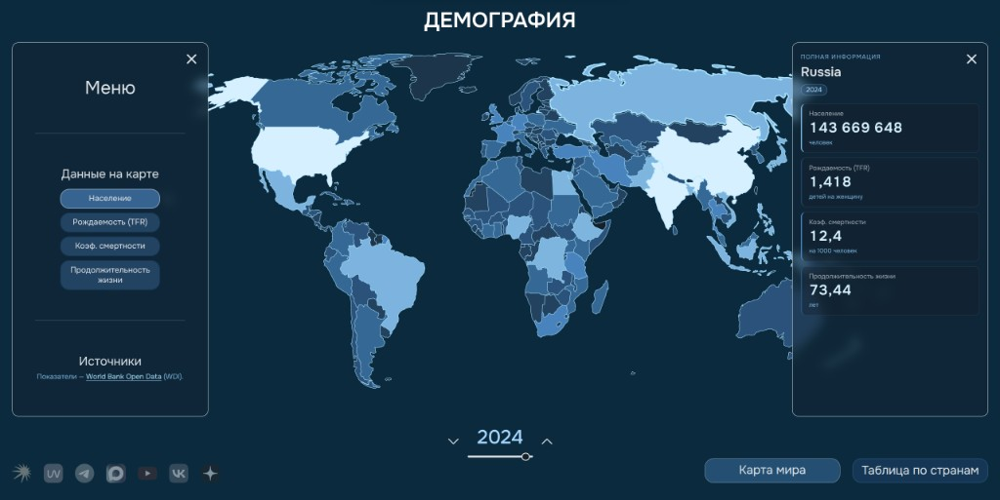

# World Demography Map

Интерактивная карта мира с демографическими показателями.
Данные запрашиваются с [World Bank Open Data](https://data.worldbank.org/) (WDI) при загрузке приложения.

Два экрана: полноэкранная карта с HUD и таблица стран с поиском.

> **Только десктоп.** Интерфейс рассчитан на широкий экран: панели, слайдер года и навигация на узкой ширине не собирались. На телефоне и планшете пользоваться не стоит.



## Возможности

- Четыре показателя: население, рождаемость (TFR), коэффициент смертности, продолжительность жизни
- Годы с 1990 по последний полный год в выборке World Bank
- Раскраска стран по значению (choropleth)
- Панель выбранной страны и список с поиском по английскому названию

## Данные

Источник — публичный API [World Bank Indicators](https://data.worldbank.org/):

| Показатель | Код |
| --- | --- |
| Население | `SP.POP.TOTL` |
| Рождаемость (TFR) | `SP.DYN.TFRT.IN` |
| Коэффициент смертности | `SP.DYN.CDRT.IN` |
| Продолжительность жизни | `SP.DYN.LE00.IN` |

Это открытые международные оценки, не официальная статистика конкретной страны.

Карта: [Natural Earth](https://www.naturalearthdata.com/) через `world-atlas` / `react-simple-maps`.

## Стек

React 18, TypeScript, Vite, SCSS Modules, React Router, `react-simple-maps`.

## Запуск

Нужны Node.js и интернет: без ответа World Bank карта не откроется.

```bash
npm install
npm run dev
```

Сборка:

```bash
npm run build
npm run preview
```

После `npm run dev` открой в браузере адрес, который выведет Vite (обычно `http://localhost:5173`).

- `/` — карта
- `/list` — таблица по странам
